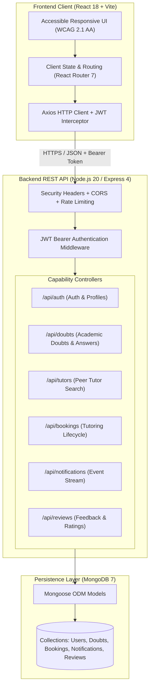
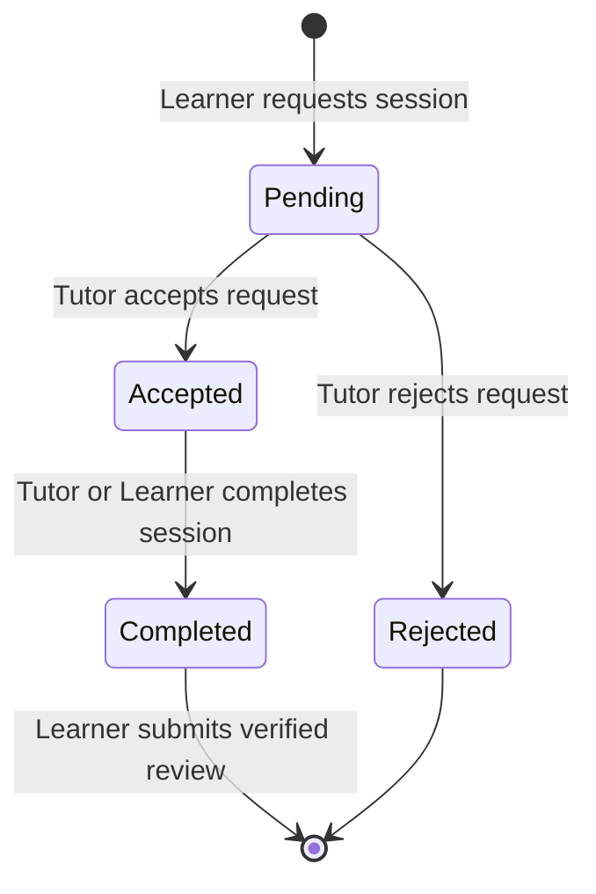

# EduBridge

<div align="center">

[](https://github.com/vincentcibin-a11y/EduBridge/actions/workflows/ci.yml)
[](https://nodejs.org/)
[](https://expressjs.com/)
[](https://react.dev/)
[](https://vite.dev/)
[](https://www.mongodb.com/)
[](https://www.docker.com/)
[](https://www.w3.org/WAI/WCAG21/quickref/)
[](LICENSE)
[](https://ktu.edu.in/)

**A full-stack, accessible peer-to-peer academic doubt solving and student tutoring platform for college communities.**

[Quick Start](#-quick-start) • [Architecture](#-system-architecture) • [Features](#-core-features) • [Accessibility](#-accessibility--inclusive-design-a11y) • [API Reference](#-api-specification) • [Academic Documentation](#-academic-documentation-suite)

</div>

---

## 📖 Overview

**EduBridge** connects college students who need academic assistance with knowledgeable peers who can answer questions or conduct structured tutoring sessions. Developed as the final MCA Main Project (Course: **20MCA246**) at the **Federal Institute of Science and Technology (FISAT)**, EduBridge integrates doubt discussion, peer tutor discovery, session scheduling, in-app notifications, and session feedback into an intuitive, accessible web platform.

### ⚡ Rapid Evaluation Flow

If you are evaluating this repository, the complete end-to-end user journey takes under two minutes:

1. **Register** two student accounts (Learner and Tutor).
2. **Set up Tutor Profile** with subjects (e.g. `DBMS`, `Python`) and skills.
3. **Ask an Academic Doubt** from the Learner account.
4. **Post an Answer** from the Tutor account; Learner marks it resolved.
5. **Discover the Tutor** via the Tutor Directory filter.
6. **Send a Tutoring Session Request** with schedule, mode (online/offline), and campus location.
7. **Accept & Complete the Session** from the Tutor account.
8. **Submit a Verified Review** and rating from the Learner account.

---

## 🏗️ System Architecture

EduBridge is built on a clean three-layer architecture with strict separation of concerns, defensive security boundaries, and responsive interfaces:



### Tutoring Session Finite State Machine



---

## 🎯 Core Features

| Module | Features & Capabilities |
|---|---|
| 🔐 **Authentication & Security** | BCrypt password hashing, JWT bearer authentication, session expiration, and in-memory rate limiting. |
| 👤 **Student Profiles** | Course, semester, college identity, academic bio, subject expertise, skill tags, and availability schedule. |
| 💬 **Academic Doubt Board** | Post doubts with subject tags, fuzzy search by keyword, markdown-safe formatting, peer answer threads, and author status resolution. |
| 🔎 **Peer Tutor Directory** | Discover verified classmates by name, subject, or skill; rank by reputation points and 1–5 star ratings. Current student is excluded. |
| 📅 **Tutoring Sessions** | Schedule online or campus offline sessions with date, time, location, and notes; manage pending, accepted, rejected, and completed states. |
| 🔔 **Notification Stream** | In-app alerts for peer answers, session requests, and status changes; unread counter badges and instant mark-as-read. |
| ⭐ **Verified Reviews** | Only the learner of a completed session can submit a rating (1–5) and review; duplicate review prevention and automatic aggregate score calculation. |

---

## ♿ Accessibility & Inclusive Design (A11Y)

In alignment with web accessibility best practices (WCAG 2.1 AA compliant):

- ⌨️ **Full Keyboard Navigation**: Skip-to-main-content landmark link (`#main-content`), interactive modal focus trapping, and `Escape` key dialog dismissal.
- 🎯 **High-Contrast Focus Indicators**: Custom `:focus-visible` ring (2px solid `#2563eb`, 2px offset) across all buttons, form fields, and navigation links.
- 🏷️ **Screen Reader Landmarks**: Explicit `<label>` associations, `aria-label`, `role="dialog"`, `aria-modal="true"`, and `aria-live="polite"` dynamic notification regions.
- 📱 **Adaptive Responsive Navigation**: Mobile hamburger drawer navigation guaranteeing complete page access on smartphones and tablets.
- 🎨 **WCAG AA Contrast Ratios**: All foreground and background text combinations rigorously satisfy the 4.5:1 minimum contrast standard.

---

## 🚀 Quick Start

### Option A: Docker Compose (Recommended)

Requires Docker Desktop or Docker Engine with Compose.

```bash
# 1. Clone the repository
git clone https://github.com/vincentcibin-a11y/EduBridge.git
cd EduBridge

# 2. Configure environment (optional, defaults provided for dev)
copy .env.example .env

# 3. Launch the complete stack
docker compose up --build
```

Access the running services:
- **Frontend Application:** [http://localhost:5173](http://localhost:5173)
- **Backend Health Check:** [http://localhost:5000/api/health](http://localhost:5000/api/health)
- **MongoDB Database:** `mongodb://localhost:27017/edubridge`

Stop services:
```bash
docker compose down
```

---

### Option B: Local Setup (without Docker)

Prerequisites: Node.js 20+, MongoDB running locally or MongoDB Atlas.

```bash
# 1. Clone repository
git clone https://github.com/vincentcibin-a11y/EduBridge.git
cd EduBridge

# 2. Install dependencies
cd backend && npm install
cd ../frontend && npm install
cd ..

# 3. Setup backend environment
cd backend
copy .env.example .env
# Start backend API (http://localhost:5000)
npm run dev

# 4. In a second terminal, start frontend (http://localhost:5173)
cd frontend
npm run dev
```

---

## 🧪 Testing & Quality Assurance

EduBridge enforces continuous verification through automated tests and strict linting:

```bash
# Run backend test suite (unit + integration against MongoDB)
npm run test

# Run backend syntax check
npm run check

# Build frontend production bundle
npm run build
```

The GitHub Actions CI pipeline runs on every push and pull request, executing:
1. Docker Compose configuration verification (`docker compose config --quiet`).
2. Docker container image builds.
3. Dependency installation using `npm ci`.
4. AST syntax checking on all backend modules (`node --check`).
5. Backend automated test suite with a live MongoDB 7 service container.
6. Production frontend compilation (`vite build`).

---

## 🔌 API Specification

All protected endpoints require the HTTP header `Authorization: Bearer <token>`.

| Method | Endpoint | Access | Description |
|---|---|---|---|
| `GET` | `/api/health` | Public | Service health, version, and security headers |
| `POST` | `/api/auth/register` | Public (Rate-limited) | Create a new student account |
| `POST` | `/api/auth/login` | Public (Rate-limited) | Authenticate student and obtain JWT |
| `GET` | `/api/auth/profile` | Protected | Retrieve authenticated student profile |
| `PUT` | `/api/auth/profile` | Protected | Update profile, bio, subjects, skills, availability |
| `GET` | `/api/doubts` | Protected | List doubts with optional `?search=` and `?subject=` |
| `POST` | `/api/doubts` | Protected | Create academic question with title, description, tags |
| `GET` | `/api/doubts/:id` | Protected | Get doubt details and peer answer thread |
| `POST` | `/api/doubts/:id/answers` | Protected | Post an answer to a doubt |
| `PUT` | `/api/doubts/:id/status` | Protected (Author) | Transition doubt status between `open` and `resolved` |
| `GET` | `/api/tutors` | Protected | Discover tutors by `?subject=`, `?skill=`, or `?search=` |
| `GET` | `/api/tutors/:id` | Protected | View tutor profile and teaching details |
| `GET` | `/api/bookings` | Protected | List tutoring sessions for current learner or tutor |
| `POST` | `/api/bookings` | Protected | Request a session with date, time, mode, and location |
| `PUT` | `/api/bookings/:id/accept` | Protected (Tutor) | Accept a pending session request |
| `PUT` | `/api/bookings/:id/reject` | Protected (Tutor) | Reject a pending session request |
| `PUT` | `/api/bookings/:id/complete` | Protected (Member) | Mark an accepted session as completed |
| `GET` | `/api/notifications` | Protected | Retrieve notifications and unread count |
| `PUT` | `/api/notifications/read-all`| Protected | Mark all notifications as read |
| `PUT` | `/api/notifications/:id/read`| Protected | Mark a single notification as read |
| `POST` | `/api/reviews/booking/:id` | Protected (Learner)| Submit 1–5 rating and review for completed booking |
| `GET` | `/api/reviews/tutor/:id` | Protected | Retrieve reviews and ratings for a peer tutor |

---

## 📚 Academic Documentation Suite

Complete academic documentation prepared in accordance with the APJ Abdul Kalam Technological University (KTU) MCA curriculum:

| Document | Purpose & Contents |
|---|---|
| 📄 **[Project Synopsis](docs/PROJECT_SYNOPSIS.md)** | Executive synopsis, problem statement, objectives, stakeholder identification, and scope. |
| 📅 **[Project Plan](docs/PROJECT_PLAN.md)** | Milestone schedule, Work Breakdown Structure (WBS), risk management matrix, and cadence. |
| 📋 **[Product Backlog](docs/PRODUCT_BACKLOG.md)** | Formal Scrum backlog (Epics PB-01 to PB-14), user stories, acceptance criteria, and refinement log. |
| 🏛️ **[System Architecture](docs/ARCHITECTURE.md)** | Three-tier architecture, component designs, entity relationship diagrams, and security boundaries. |
| 🧪 **[Testing & Validation](docs/TESTING_AND_VALIDATION.md)** | Comprehensive testing strategy, test metrics, verification matrix, and traceability. |
| 📑 **[Project Documentation](docs/EduBridge_Project_Documentation.md)** | Full academic report detailing methodology, requirements, ERD, APIs, and future enhancements. |
| 📓 **[EduBridge Scrum Book](docs/EduBridge_Scrum_Book.md)** | Sprint logs, meeting records, guide feedback registers, velocity tracking, and version records. |
| ✅ **[Final Submission Checklist](docs/Final_Submission_Checklist.md)** | Verification gate covering code, CI, Docker, manual tests, evidence, and deliverables. |
| 🔍 **[Manual Acceptance Evidence](docs/Manual_Acceptance_Test_Evidence.md)** | Detailed verification procedures and evidence records for browser and operational journeys. |
| 📸 **[Screenshot Evidence Guide](docs/evidence/README.md)** | Screenshot naming conventions, privacy protection, and evidence gallery guidelines. |

---

## 🔒 Security Practices

- **Zero Secret Ingestion**: All sensitive secrets managed via environment variables; `.env` excluded from version control.
- **Production Guardrails**: Server refuses to boot in production if `JWT_SECRET` is missing or fewer than 32 characters.
- **Rate Limiting**: Protects authentication endpoints from credential-stuffing and API endpoints from traffic bursts.
- **Strict Payload Constraints**: 1 MB body size ceiling and field length limits to prevent resource exhaustion attacks.
- **Defensive Headers**: `X-Content-Type-Options: nosniff`, `X-Frame-Options: DENY`, `Referrer-Policy: no-referrer`, and `Cache-Control: no-store` on all API routes.
- **ReDoS Prevention**: User search inputs sanitized with regex character escaping before executing query patterns.

See [SECURITY.md](SECURITY.md) for vulnerability disclosure procedures.

---

## 🎓 Academic Metadata

- **Student:** Cibin Vincent (FIT25MCA-2028)
- **Programme:** Master of Computer Applications (MCA)
- **Course:** 20MCA246 — Main Project
- **Institution:** Federal Institute of Science and Technology (FISAT), Angamaly
- **Project Guide:** Ms. Senu Abi

---

## 📄 License

This project is licensed under the MIT License — see the [LICENSE](LICENSE) file for details.
