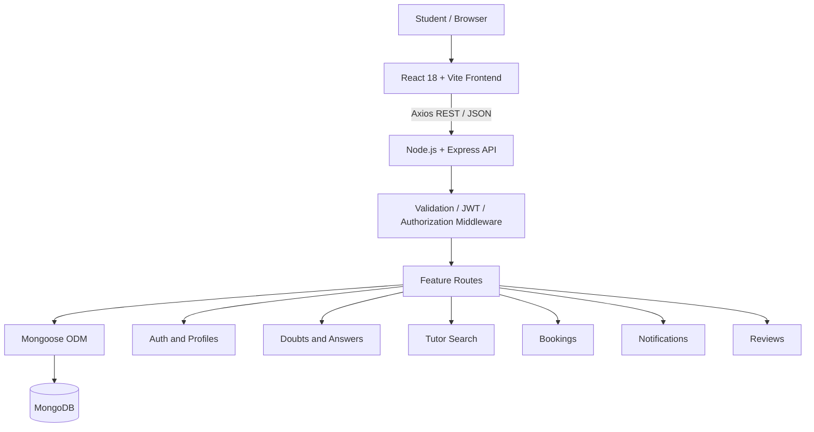
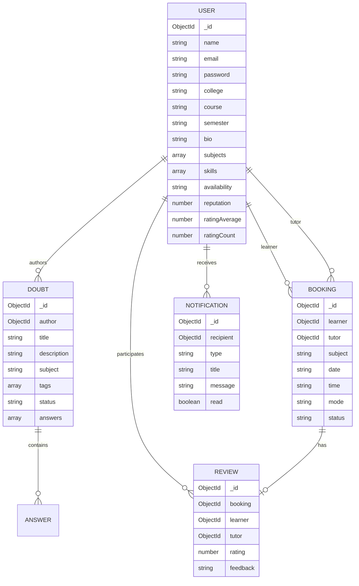
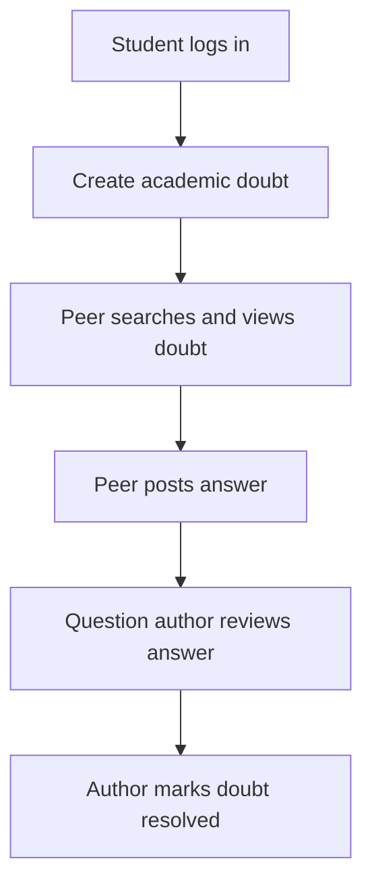
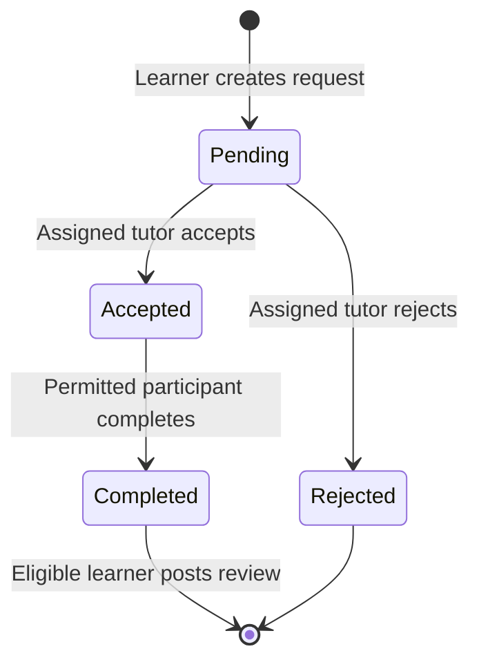
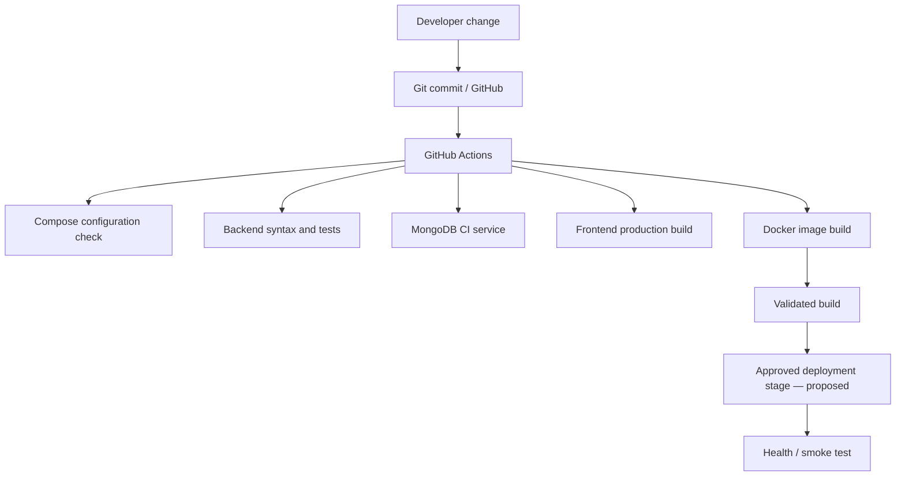

# EduBridge Architecture Specification

## 1. Overview

EduBridge is a three-tier web application for student peer learning. The React frontend presents doubt-sharing, tutor-discovery and session workflows. The Express backend exposes REST APIs and applies validation, authentication, authorisation and business rules. MongoDB stores the application data through Mongoose models.

## 2. Component design

### 2.1 Presentation layer — frontend

The React client provides:
- Registration and login.
- Student dashboard and profile.
- Academic doubt listing, creation, search and answer threads.
- Tutor discovery and tutor profile.
- Tutoring session requests and booking status management.
- Notifications and read-state controls.
- Review submission for completed sessions.

The frontend calls the backend through Axios. Client-side validation improves usability; server-side validation remains authoritative.

### 2.2 Application layer — backend

The Node.js/Express API validates requests, verifies JWTs, checks resource ownership and applies application rules.

| Component | Responsibility |
|---|---|
| `backend/server.js` | Server startup and database connection |
| `backend/app.js` | Express application, common middleware and route registration |
| `backend/middleware/auth.js` | JWT verification and authenticated user context |
| `backend/middleware/rateLimiter.js` | Request rate limiting |
| `backend/routes/auth.js` | Registration, login and profile |
| `backend/routes/doubts.js` | Doubt listing, creation, answers and status |
| `backend/routes/tutors.js` | Peer tutor discovery |
| `backend/routes/bookings.js` | Tutoring request lifecycle |
| `backend/routes/notifications.js` | User-specific notifications |
| `backend/routes/reviews.js` | Review eligibility and tutor feedback |

### 2.3 Data layer — MongoDB

Mongoose models define the persistent documents.

| Model | Purpose |
|---|---|
| User | Account, profile, subject/skill details and rating summary |
| Doubt | Academic question, tags, status and embedded answers |
| Booking | Learner/tutor session request and state |
| Notification | Recipient, event content and read flag |
| Review | Booking-linked rating and feedback |

## 3. Logical data relationships

Doubt answers are embedded subdocuments, not a separate collection. Verify exact model fields and indexes against the final Mongoose schemas before submission.

## 4. Main application workflows

### 4.1 Doubt-solving workflow

### 4.2 Tutoring workflow

## 5. Security and validation boundaries

- Passwords are hashed with bcryptjs.
- Protected APIs use JWT authentication.
- Resource ownership is checked for user-specific operations.
- Booking decisions and completion follow explicit state rules.
- Review submission is restricted to eligible completed bookings.
- Request types, lengths and database identifiers are validated server-side.
- Rate limiting and defensive response headers are configured in the API.
- Production JWT secrets and database credentials must be injected through protected environment settings, never committed to source control.

## 6. Git, testing and delivery pipeline

The repository currently provides continuous integration and Docker image build validation. The deployment stage in this diagram is proposed; it is not a claim that production deployment is automated or completed.

## 7. Deployment requirements

Before a public production deployment:
1. Select and approve the hosting provider.
2. Configure a production MongoDB database and strong JWT secret through protected environment variables.
3. Configure the frontend origin and CORS.
4. Enable HTTPS and suitable logging/backup practices.
5. Deploy the exact validated commit or release tag.
6. Run the API health check and critical smoke tests.
7. Record deployed URL, date, commit SHA, logs and rollback plan.

## 8. Course outcome traceability

| Course outcome | Architecture / engineering evidence |
|---|---|
| CO1 — Real-life project selection | Peer-learning problem statement and stakeholder context |
| CO2 — Requirements discovery | Actual learner/tutor and guide consultation records |
| CO3 — Development methodology | Five two-week Scrum increments, check-ins and reviews |
| CO4 — Analysis and design | Requirements, architecture, ERD and UI design |
| CO5 — Module testing | API/integration tests, regression runs, manual acceptance and CI |
| CO6 — Build and integration | Integrated React, Express and MongoDB modules |
| CO7 — Documentation and deployment | Synopsis, report, Scrum Book, version register and deployment evidence |
