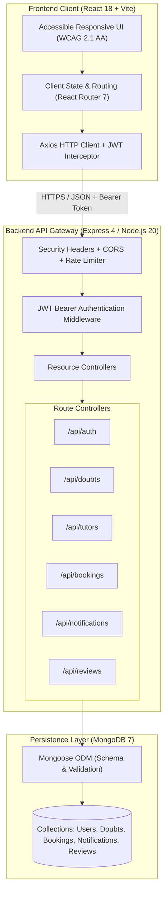
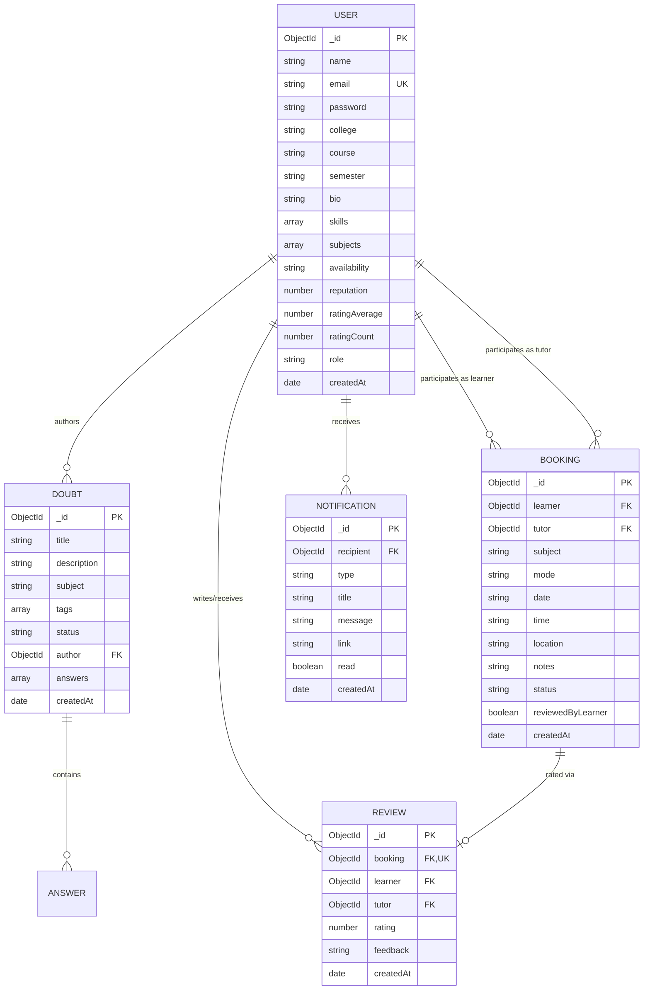

# EduBridge Architecture Specification

## 1. Overview & System Context

EduBridge is a modular three-tier web application designed for academic doubt solving and peer tutoring across college campuses.



---

## 2. Component Design

### 2.1 Frontend Architecture (`frontend/`)
The frontend client provides responsive, accessible interfaces built with React 18:
- **Authentication**: JWT login, registration, college profile onboarding.
- **Academic Doubt Board**: Create questions, search by tags and keywords, post peer answers, and mark questions resolved.
- **Tutor Discovery**: Discover peer tutors by subject, skill tags, reputation score, and rating averages.
- **Session Management**: Send session requests (online/offline), accept/reject incoming bookings, mark sessions completed.
- **Activity & Notifications**: Real-time unread activity counters, instant mark-as-read, and deep links.
- **Session Reviews**: Post-completion rating (1–5 stars) and qualitative feedback.
- **Accessibility Engine**: Semantic HTML5 landmarks, ARIA live regions, keyboard focus traps, skip-to-content links, and responsive navigation.

### 2.2 Backend Architecture (`backend/`)
The Express application implements a RESTful service structure:
- `middleware/rateLimiter.js`: In-memory rate limiting to protect authentication routes from brute force and mitigate denial-of-service attempts.
- `middleware/auth.js`: Cryptographic JWT verification and user context hydration.
- `routes/auth.js`: Registration, bcrypt hashing, credential authentication, and profile mutations.
- `routes/doubts.js`: Academic question publishing, regex-escaped queries, peer answer threads, and status updates.
- `routes/tutors.js`: Tutor index with fuzzy subject/skill filtering and reputation ranking.
- `routes/bookings.js`: Finite state machine managing booking lifecycle:
  ```mermaid
  stateDiagram-v2
      [*] --> Pending: Learner requests session
      Pending --> Accepted: Tutor accepts request
      Pending --> Rejected: Tutor rejects request
      Accepted --> Completed: Either party marks session completed
      Completed --> [*]: Learner submits review
  ```
- `routes/notifications.js`: Inbox event stream and read receipt updates.
- `routes/reviews.js`: Post-session evaluation, duplicate review prevention, and incremental tutor rating aggregation.

---

## 3. Data Model & Entity Relationships



---

## 4. Security & Compliance Boundaries

1. **Authentication & Secret Safety**:
   - Passwords salted and hashed with `bcryptjs`.
   - JWT tokens signed with a cryptographically enforced secret (`>= 32` characters in production).
   - `.env` excluded from version control; templates documented in `.env.example`.
2. **Defensive Validation**:
   - Maximum payload bounds (1 MB request size limit).
   - Input type, string length, and format enforcement on all endpoints.
   - ReDoS protection via strict query regex escaping (`escapeRegex`).
3. **Authorization & Role Integrity**:
   - Booking transitions verified against learner/tutor object IDs.
   - Review creation restricted to the verified learner of a completed session.
   - Notifications restricted to the target recipient.
4. **Transport & Network Controls**:
   - Controlled CORS origin white-listing.
   - HTTP response hardening (`X-Content-Type-Options: nosniff`, `X-Frame-Options: DENY`, `Referrer-Policy: no-referrer`, `Cache-Control: no-store`).
   - Rate limiting on sensitive endpoints.

---

## 5. DevOps & Continuous Integration Pipeline

GitHub Actions executes the automated quality pipeline on every push and pull request:
1. Validates `docker-compose.yml` structure.
2. Builds frontend and backend Docker container images.
3. Installs dependencies using `npm ci`.
4. Performs AST syntax validation across all backend JavaScript modules (`node --check`).
5. Executes automated unit and integration tests against a live MongoDB 7 service container.
6. Builds the production frontend bundle using Vite (`vite build`).
