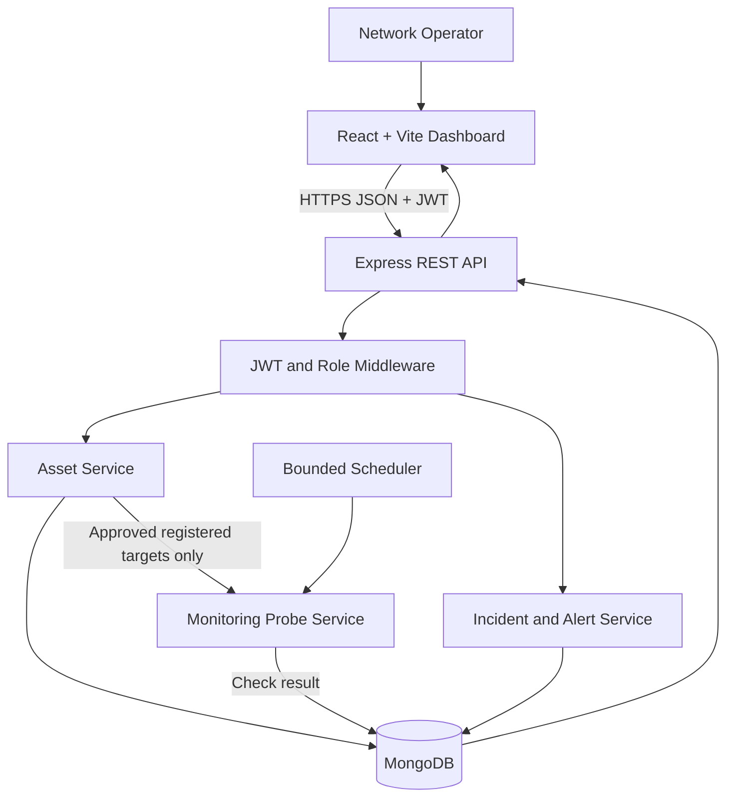
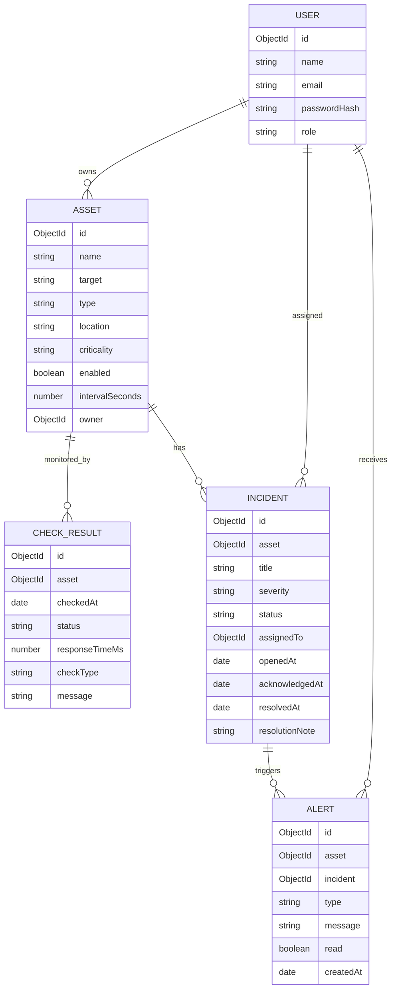

# NetPulse — Architecture and Design

## 1. System overview

NetPulse is a three-tier web application. The operator uses a responsive React dashboard. An Express API authenticates users, authorises access, validates asset configuration and exposes inventory, monitoring, incident and alert endpoints. A monitoring service performs bounded checks against registered, approved targets and stores immutable results in MongoDB.

## 2. Proposed modules
- Authentication and role management.
- Asset inventory and target allow-list.
- Probe service: HTTP(S) check and optionally controlled ICMP check.
- Scheduler: bounded interval, timeout and concurrency.
- Monitoring history and summary metrics.
- Incident lifecycle and deduplicated alerts.
- Reports, audit trail, and health endpoints.

## 3. Data model

## 4. Core API proposal

| Method | Endpoint | Purpose |
|---|---|---|
| POST | /api/auth/register, /login | Identity |
| GET | /api/assets | List authorised assets |
| POST | /api/assets | Register approved asset |
| GET | /api/assets/:id | Asset details |
| PATCH | /api/assets/:id | Update asset |
| DELETE | /api/assets/:id | Deactivate asset (soft delete) |
| POST | /api/assets/:id/check | Run on-demand check for registered asset |
| GET | /api/assets/:id/checks | Asset history |
| GET | /api/monitoring/summary | Dashboard metrics |
| GET/POST | /api/incidents | List/create incidents |
| PATCH | /api/incidents/:id | Update status, severity, assignment |
| GET | /api/alerts | List current user's alerts |
| PATCH | /api/alerts/:id/read | Mark alert read |
| GET | /api/reports/checks.csv | Export filtered check history |

## 5. Safety and security controls
- Never accept arbitrary probe commands from the browser. The API selects a registered asset by database ID and checks the user's permissions.
- Enforce an approved-target policy at asset creation and again before each probe. Do not permit arbitrary CIDR sweeps or user-supplied command arguments.
- Use strict HTTP(S) URL parsing, reject unsupported protocols, restrict redirects, and apply connection/read timeouts.
- For ICMP, use a fixed executable/argument mapping, no shell interpolation, a timeout, and explicit deployment permission. If unavailable, show “unsupported” rather than treating it as reachable.
- Bound intervals and worker concurrency. Add per-user/API rate limits and deduplicate alerts.
- Do not store credentials, request bodies, response bodies, or secrets from monitored services.
- Store production secrets in environment variables/secrets manager; never commit .env files.
- Log operator actions and avoid exposing sensitive network topology to unauthorised users.

## 6. UI screens
1. Sign in.
2. Overview: device totals, up/down/unknown, availability and recent incident counts.
3. Assets: filter/search, register/edit/deactivate.
4. Asset detail: latest status, response-time chart and check history.
5. Incidents: filter by severity/status, acknowledge, resolve with note.
6. Alerts: unread/read, state changes.
7. Settings: approved network policy, check interval and role controls.

## 7. Deployment topology
Docker Compose runs React/Vite (or production static server), Express API and MongoDB. The monitoring worker runs inside the backend process or a separate worker container with bounded concurrency. Expose only required ports. Keep MongoDB private to the Compose network. Configure JWT secret and database URI from environment variables.
